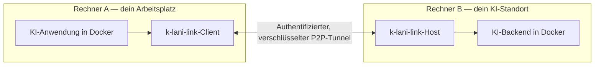

# k-lani-link

<!-- WINDOWS-DOWNLOADS:START -->
## Windows herunterladen

**[⬇ Windows x64: EXE herunterladen](https://github.com/MarvKalani/k-lani-link/releases/download/v1.2610.29-preview.3/k-lani-link-1.2610.29-preview.3-windows-x64.exe)** · **[⬇ OpenCode + Docker: Setup-ZIP](https://github.com/MarvKalani/k-lani-link/archive/refs/heads/main.zip)**

| Was möchtest du nutzen? | Download | Anleitung |
| --- | --- | --- |
| Portable EXE für Intel-/AMD-PCs | [Windows x64 als ZIP](https://github.com/MarvKalani/k-lani-link/releases/download/v1.2610.29-preview.3/k-lani-link-1.2610.29-preview.3-windows-x64.zip) | [Native Einrichtung](deploy/portable/README.md#windows-connect-to-a-remote-model) |
| Windows auf ARM, z. B. Snapdragon | [ARM64 EXE](https://github.com/MarvKalani/k-lani-link/releases/download/v1.2610.29-preview.3/k-lani-link-1.2610.29-preview.3-windows-arm64.exe) · [ARM64 ZIP](https://github.com/MarvKalani/k-lani-link/releases/download/v1.2610.29-preview.3/k-lani-link-1.2610.29-preview.3-windows-arm64.zip) | [Native Einrichtung](deploy/portable/README.md#windows-connect-to-a-remote-model) |
| OpenCode im Browser, isoliert mit `D:\OpenCode` | [Aktuelles Docker-Setup als ZIP](https://github.com/MarvKalani/k-lani-link/archive/refs/heads/main.zip) | [Docker-Desktop-Einrichtung](deploy/desktop/README.md) |

**Neueste veröffentlichte portable Version: 1.2610.29-preview.3 (Vorschau).**
[Versionshinweise](https://github.com/MarvKalani/k-lani-link/releases/tag/v1.2610.29-preview.3) · [Änderungen seit diesem Build](https://github.com/MarvKalani/k-lani-link/compare/v1.2610.29-preview.3...main) · [SHA-256-Prüfsummen](https://github.com/MarvKalani/k-lani-link/releases/download/v1.2610.29-preview.3/SHA256SUMS) · [macOS / Linux / alle Downloads](https://github.com/MarvKalani/k-lani-link/releases)

Das Docker-ZIP enthält den aktuellen Quellstand samt Starter; die Images werden einmalig lokal gebaut. Die EXE enthält nur den Transport, keine OpenCode-Oberfläche; normale Quellcode-Pushes erneuern sie nicht. Der Windows-/Firmennetz-Test des Docker-Profils steht noch aus.
<!-- WINDOWS-DOWNLOADS:END -->

> **MVP-Entwicklungsstand:** Linux-Docker-Installation geprüft. Der Lizenzverkauf bleibt während der Vorbereitung des Kaufablaufs pausiert.

### Deine KI auf einem Rechner deiner Wahl. Deine Anwendungen dort, wo du arbeitest.

[English](README.md) · [Einrichten](QUICKSTART.md) · [Changelog](CHANGELOG.md) · [Auf Ko-fi unterstützen](https://ko-fi.com/mkalani)

**k-lani-link ist eine verschlüsselte Brücke zwischen deinen KI-Anwendungen und einem KI-Endpunkt auf einem anderen Rechner deiner Wahl.**

Dieser Rechner kann zu Hause, im Büro oder als GPU-Server in einem Rechenzentrum
stehen. Deine Anwendung spricht eine lokale, OpenAI-kompatible API an. k-lani-link
überträgt ihre Anfragen und die gestreamten Antworten zwischen den beiden
Rechnern. Das Modell läuft auf dem Backend-Rechner; dein Arbeitsgerät braucht
dafür keine eigene Inferenz-GPU.

Du kannst Anwendungen anbinden, die die jeweilige OpenAI-kompatible API und
einen eigenen Endpunkt unterstützen: Coding-Werkzeuge, Chat-Oberflächen,
Skripte und eigene Software. OpenCode und Cline sind Beispiele für Clients.
**Von Rechner X zu Rechner Y: Du wählst, welche KI du erreichen möchtest.**
Das kann dein eigenes Modell sein oder ein Endpunkt, den ein anderer Betreiber
für dich bereitstellt. **Verbinde jedes Backend, das die unterstützten
OpenAI-kompatiblen Chat-Endpunkte implementiert.** Der Transport ist von der
Inferenz-Engine getrennt. Basalt ist die getestete Referenzinstallation;
andere lokale Backends lassen sich ausdrücklich freigeben.
[Kompatibilität und Einrichtung](#deine-anwendung-dein-backend).

## Was du damit bekommst

| Dein Nutzen | So setzt k-lani-link ihn um |
| --- | --- |
| Rechenleistung auf einem anderen Rechner nutzen | Das Modell bleibt dort, wo GPU und Speicher stehen. Deine Anwendungen erreichen es über eine lokale API. |
| Antworten beim Entstehen sehen | Text, Reasoning und Tool-Aufrufe werden fortlaufend übertragen. Welche Funktionen nutzbar sind, bestimmen Backend und Anwendung. |
| Modelle ohne erneute Kopplung wechseln | Die optionale Basalt-Verwaltung lädt und entlädt freigegebene Modelle, während der Tunnel verbunden bleibt. |
| Mehrere Anfragen bedienen | Bis zu acht Streams pro Tunnel mit begrenzter Warteschlange; das Backend muss die gewählte Parallelität unterstützen. |
| Inferenzverkehr zwischen deinen gewählten Gegenstellen halten | Authentifiziertes WebRTC mit zusätzlicher Inhaltsverschlüsselung. Der Vermittler erhält verschlüsselte Aufbaupakete; seine Verbindung endet, sobald der Tunnel steht. |
| Infrastruktur selbst wählen | Eigene Vermittlungs- und STUN-Server konfigurieren. TURN ist standardmäßig aus und wird nur ausdrücklich aktiviert. |
| Anwendungen isoliert betreiben | Die Docker-Vorlagen geben KI-Client und Modellserver keine Internetroute. Eigene Transportkomponenten stellen die Verbindung her. |
| Ohne Aktivierungsdienst arbeiten | Keine Online-Lizenzprüfung, Geräteregistrierung oder laufende Lizenzgebühr für Version 1.x. |

## Zwei Rechner. Zwei isolierte Anwendungen. Eine verschlüsselte Verbindung.

Unser Docker-Setup isoliert **zwei Anwendungscontainer**: den KI-Client auf der
einen und den Inferenzserver auf der anderen Seite. Zusätzliche kleine Container
übernehmen den Transport und bei Bedarf den Browserzugang. Die Anwendungen
sprechen über private Unix-Sockets; k-lani-link stellt die Netzwerkverbindung her.
Für Tests können beide Seiten auch auf demselben Rechner laufen.

So lässt sich ein entferntes Modell nutzen, ohne seine eigentliche API als
öffentlichen Dienst freizugeben. Im mitgelieferten Profil für lokale Modelle
findet die Inferenz auf deinen gewählten Rechnern statt. k-lani-link erzeugt keine Verkehrslogs oder Telemetrie.
Feste Startmeldungen helfen
bei Konfigurations- und Kopplungsfehlern, ohne Schlüssel oder übergebene Werte
auszugeben. Die optionale Ressourcenmessung erfasst Zähler, keine Prompts oder
Antworten.

## Deine Anwendung, dein Backend

**Auf der Client-Seite:** Die Anwendung muss eine eigene OpenAI-kompatible Base
URL, einen API-Schlüssel und eine Modell-ID unterstützen. k-lani-link reicht
Modellliste, Chat Completions und Responses weiter. Das jeweilige API-Format
bleibt erhalten; eine Übersetzung zwischen APIs findet nicht statt. OpenCode,
ThinkRail/Pi und der Codex-Agentenkern sind getestet. Für Cline gibt es ebenfalls
eine Konfigurationsanleitung.

**Auf der Backend-Seite:** Verwende einen OpenAI-kompatiblen Chat-Server, etwa
[Basalt](https://github.com/jesdga95/basalt),
[Strata](https://github.com/niko1221/strata),
[Maya](https://github.com/mw00/project-maya),
[LM Studio](https://lmstudio.ai/docs/developer/openai-compat),
[llama.cpp](https://github.com/ggml-org/llama.cpp),
[vLLM](https://docs.vllm.ai/) oder [Ollama](https://docs.ollama.com/api/openai-compatibility).
Das sind Beispiele, keine abgeschlossene Liste von Engines. Client und Server
müssen denselben Endpunkt und die angefragten Funktionen unterstützen,
einschließlich Streaming und Tool-Aufrufen.

| Anbindung | Aktueller Stand |
| --- | --- |
| Basalt-Referenzinstallation | Getestet, einschließlich Docker-Isolation und optionaler Modellsteuerung |
| Andere lokale OpenAI-kompatible Chat-Server | Allgemeine Anbindung vorhanden; Integration und Datenschutzprüfung erfolgen je Backend |
| Gateway zu Cloud-Anbietern | Geplant, mit ausdrücklicher Cloud-Betriebsart |

Die Inferenzrouten sind `/v1/models`, `/v1/chat/completions`, `/v1/responses` und
`/v1/embeddings` (OpenAI) sowie `/v1/messages` (Anthropic, für Claude Code mit eigenem
Modell); siehe [unterstützte APIs](docs/REFERENCE.de.md#unterstützte-apis).
Modellladen, KV-Cache-Speicherung und andere Verwaltungsfunktionen sind separat.
[API-Konventionen und Open Responses](deploy/BACKENDS.md#api-conventions-and-open-responses).

**Andere lokale Server:** Standardmäßig verlangt der Host das Datenschutzprofil
des Backends. Für einen
anderen lokalen OpenAI-kompatiblen Server kannst du in `host.toml` ausdrücklich
`allow_unverified_backend = true` setzen und dessen Loopback-`upstream` eintragen.
Dann entfällt die Profilprüfung, und k-lani-link warnt beim Start. Die
verschlüsselte Verbindung bleibt erhalten. Logging, Speicherung und Netzzugang
des Backends musst du selbst prüfen. Unsere Basalt-Modellverwaltung lässt sich
mit dieser Freigabe nicht aktivieren.
[Konfigurationsbeispiel und genaue Grenzen](deploy/BACKENDS.md#connect-another-local-server).

**Geplanter Cloud-Gateway:** Rechner B könnte auch OpenAI oder einen anderen
Anbieter für dich aufrufen. Dieser Adapter muss noch gebaut werden. Der gewählte
Anbieter erhielte dabei die Inferenzdaten; diese Betriebsart unterscheidet sich
vom isolierten Setup mit einem lokalen Modell.

[Client-Einrichtung und Protokollreferenz](docs/REFERENCE.de.md) · [Backend-Fähigkeiten und nächste Schritte](deploy/BACKENDS.md)

## Im Labor erprobt

OpenCode hat über die verschlüsselte Verbindung ein lokales Qwen-Modell in
Basalt verwendet, um mit WordCraft/GridCraft eine **Kundenrechnung, ein PDF,
eine Excel-Tabelle und eine englische Projektwebsite** zu erstellen. Alle
Kundendaten waren fiktiv; CPU, RAM und GPU wurden mitgemessen.

**[Englisches Demo-Video ansehen / herunterladen (MP4, 87 Sekunden)](https://github.com/MarvKalani/k-lani-link/releases/download/v1.2610.29/k-lani-link-business-demo.mp4)**
· [Schnittdokumentation und GIFs](assets/demo/README.md)

Das ist ein bearbeiteter Archivmitschnitt vom 27.–28. Oktober, kein neuer
Modelllauf. Alte Namenseinblendungen und Anbieterbezeichnungen sind verdeckt;
die gezeigten Modellausgaben und Ressourcenwerte bleiben unverändert.
Codex lieferte Prompts, Rückfragen und Review. Beide Gegenstellen liefen auf
einem Rechner mit fiktiven Daten. Die Aufnahme entstand vor dem Token/s-Exporter;
spätere Leistungswerte wurden nicht eingefügt. Die Dokumente bleiben unverändert.
Spätere Änderungen an Website und Artwork sind in
[der Herkunftsdokumentation](website/README.md) ausgewiesen.
[Hardware und Messwerte](deploy/HARDWARE.md) · [Demo-Ablauf](deploy/opencode/DEMO.md).

Der neue Test der Modellverwaltung wechselte **Coder → NVFP4 → Coder → entladen**
über denselben Tunnel, nachdem der Vermittler gestoppt war. Zwölf kurze Anfragen
liefen paarweise; beide Modelldateien lagen auf demselben RAID-0-Dateisystem.
Das erfolgreiche Profil verwendete 6 GiB Backend-RAM, keinen Swap und zwei Slots
mit jeweils 262.144 Token Kapazität. Diese Kontexte wurden nicht gefüllt; der Test
prüft Funktionen, keine Antwortqualität oder repräsentative Geschwindigkeit.
[Ergebnisse und Grenzen](deploy/managed/validation-20261028.json)
· [Test nachvollziehen](deploy/managed/README.md#reproduce-the-gpu-validation).

**Entwicklungsstand:** Der [Vergleich von sieben Transportvarianten](deploy/mailbox-bench/DECISION.md)
umfasst jetzt 63 kontrollierte Fälle mit 50/100 Token pro Sekunde, 1/10 Tunneln,
60 Sekunden Last, Proxy-Pufferung und Wiederverbindung. Die ausgewählte Mailbox mit
bestätigten Mehrfachabrufen ist jetzt als **ausdrückliche Quellcode-Vorschau** eingebunden:
mit TLS-Prüfung, dauerhaftem Kopplungszustand und SSE-Weiterleitung durch Host/Gateway.
[Privates HTTPS-Setup, Tests und Grenzen](deploy/https/README.md). Die veröffentlichten
preview.3-Downloads und das Verbindungspanel verwenden weiterhin WebRTC; HTTPS ist
kein automatischer Fallback. Die Vorschau ist weder ein öffentlicher Relay-Dienst
noch eine Durchsatzzusage. [Umsetzungscheckliste](docs/HTTPS-IMPLEMENTATION.md)
· [Unveränderter Übertragungsvertrag](docs/DESIGN-MAILBOX.md) · [Changelog](CHANGELOG.md).
Die [Lasttests des tatsächlichen Anwendungspfads](deploy/https/RESULTS.md) zeigten zunächst
einen Engpass in der Antwort-Flusskontrolle; nach der dokumentierten Korrektur laufen alle
vier synthetischen Fälle mit 50/100 Token/s live durch. HTTPS bleibt ein privater Teststand,
bis Abnahmetests mit echtem WAN, Proxy und echter Inferenz bestanden sind.

## Mit Docker starten

Die aktuelle Referenzinstallation verwendet **Linux x86_64 mit Docker Compose**.
Für das getestete Basalt-Backend kommen eine unterstützte NVIDIA-GPU, das NVIDIA
Container Toolkit und eine passende Modelldatei hinzu. Modellgewichte stellst
du selbst bereit.

1. Images bauen und einen privaten Kopplungscode erzeugen.
2. Backend und k-lani-link-Host auf Rechner B starten.
3. k-lani-link und die Anwendung auf Rechner A starten und deren lokalen API-Endpunkt eintragen.

**[Zur Anleitung für zwei Rechner →](QUICKSTART.md)**

**Windows mit Docker Desktop:** Das separate [OpenCode-Browserprofil](deploy/desktop/README.md)
bindet nur `D:\OpenCode` als Projektordner ein. OpenCode hat keine externe
Netzwerkschnittstelle; k-lani-link stellt die Modellverbindung über einen privaten
Socket bereit. Ein PowerShell-Starter baut und startet den Aufbau und prüft seine
Grenzen. Die Abnahme auf Windows/Docker Desktop und im echten Firmennetz steht noch aus.

Beide Gegenstellen brauchen Netzwerkzugang. Über das Internet müssen ihre
Netze direkten Peer-Verkehr zulassen; Internetzugang allein garantiert noch
keine erfolgreiche NAT-Durchquerung. Scheitert die direkte ICE-Verbindung,
**musst du derzeit einen eigenen TURN-Server mitbringen** und dessen Adresse
und Zugangsdaten ausdrücklich konfigurieren. k-lani-link betreibt und liefert
keinen TURN-Dienst. Ein automatischer Relay-Fallback findet nicht statt.

## Portable Programme für Windows, macOS und Linux

Die nativen Varianten bestehen aus einem Programm ohne Installer:
Windows x64/ARM64, macOS Intel/Apple Silicon und Linux x64/ARM64. Sie starten in
PowerShell oder einem Terminal und verwenden denselben verschlüsselten Tunnel.
Ab **1.2610.29-preview.3** öffnet ein Doppelklick außerdem eine lokale
Bedienoberfläche mit Konfigurationsimport, Verbindungsstatus und Backend-Test.
Die frühere EXE **1.2610.29** hat diese Oberfläche noch nicht. Eine Tray-Anzeige
ist in dieser Vorschau noch nicht enthalten.
Die ersten Downloads sind unsignierte Vorabversionen; Schutzsoftware oder
Unternehmensrichtlinien können sie blockieren. Der native Betrieb bietet keine
Docker-Isolation der KI-Anwendungen.
[Downloads](https://github.com/MarvKalani/k-lani-link/releases)
· [Einrichtung, Plattformgrenzen und Prüfsummen](deploy/portable/README.md).

## Einmalig 4,99 €. Alle Versionen 1.x.

Eine Lizenz gilt für **eine Person**, auf beliebig vielen Geräten und in
beliebig vielen Containern, einschließlich ihrer KI-Agenten. Teams kaufen einen
Platz pro menschlichem Nutzer. Eine Online-Aktivierung ist nicht erforderlich.

Produktive Nutzung ist kostenlos für Personen, die für sich selbst handeln
und unter **100.000 USD Bruttojahreseinkommen** liegen, sowie für Organisationen
unter **100.000 USD Gruppenjahresumsatz**. Bei Arbeit für ein Unternehmen zählt
der Gruppenumsatz. Nichtproduktives Ausprobieren ist unter der BSL unabhängig
von diesen Grenzen erlaubt.

**Der Lizenzverkauf bleibt während der Vorbereitung von Kaufablauf und Vertragsunterlagen pausiert.**
· [Freigrenzen und Nutzerdefinition](LICENSING.md)
· [Kommerzielle Lizenzbedingungen](COMMERCIAL-LICENSE.md)

Der Quellcode steht unter **BSL 1.1**. Diese Version wechselt gemäß
[Lizenz](LICENSE) am 28. Oktober 2030 zu Apache-2.0. Der Preis gilt für k-lani-link;
Modellgewichte, Rechenleistung, Cloud-Anbieter und TURN-Dienst sind separat.

## Entwicklung unterstützen

Wenn du das Projekt unabhängig von einem Lizenzkauf unterstützen möchtest,
kannst du **[Marvin auf Ko-fi unterstützen](https://ko-fi.com/mkalani)**.
Das ist freiwillig und kauft oder ersetzt keine erforderliche Lizenz.

## Stand dieser Version

Der öffentliche Branch `main` enthält den Entwicklungsstand eines MVPs. Pro Tunnel sind
ein bis acht Streams mit begrenzter Warteschlange konfigurierbar (Standard: einer).
Die optionale Basalt-Verwaltung wechselt vorab freigegebene Modelle, während der
Tunnel verbunden bleibt. Gespeicherter KV-Zustand und Browser-Erweiterung fehlen
noch. [Modellsteuerung und parallele Streams](deploy/managed/README.md).
SIGTERM/Ctrl-C räumen ungenutzte Kopplungsreservierungen jetzt auf; ein durch
einen aufgebauten Tunnel verbrauchter Code bleibt verbraucht. In der
aufgezeichneten Demo liefen beide Gegenstellen auf einem Host; daraus lässt
sich keine Leistung einer Verbindung zwischen zwei entfernten Netzen ableiten.

Änderungen stehen in [CHANGELOG.md](CHANGELOG.md). Versionen mit Git-Tag und
Downloads gehören auf [GitHub Releases](https://github.com/MarvKalani/k-lani-link/releases).
Der aktuelle Quellcode ist ein MVP. Portable Builds haben eigene native CI-Prüfungen;
veröffentlichte Versionen nennen Quellcode-Commit und Testgrenzen. Die
[Anleitung für portable Builds](deploy/portable/README.md) erklärt Signaturstatus
und Plattformunterstützung.

k-lani-link überträgt KI-API-Anfragen. Remote Desktop, beliebiger Dateizugriff und
andere Netzwerkdienste gehören nicht zum Funktionsumfang. Clients können lokale
Verläufe führen und Dateien schreiben. Verschlüsselung und Docker-Isolation
unterstützen einen datenschutzbewussten Betrieb; rechtmäßige Verarbeitung und
DSGVO-Konformität hängen weiterhin von der konkreten Nutzung ab.

[Sicherheitsmodell](docs/SECURITY.de.md)
· [Technische Referenz](docs/REFERENCE.de.md)
· [Drittanbieter-Lizenzen](THIRD_PARTY.md)

[Name change and existing installations](docs/REBRANDING.md)
