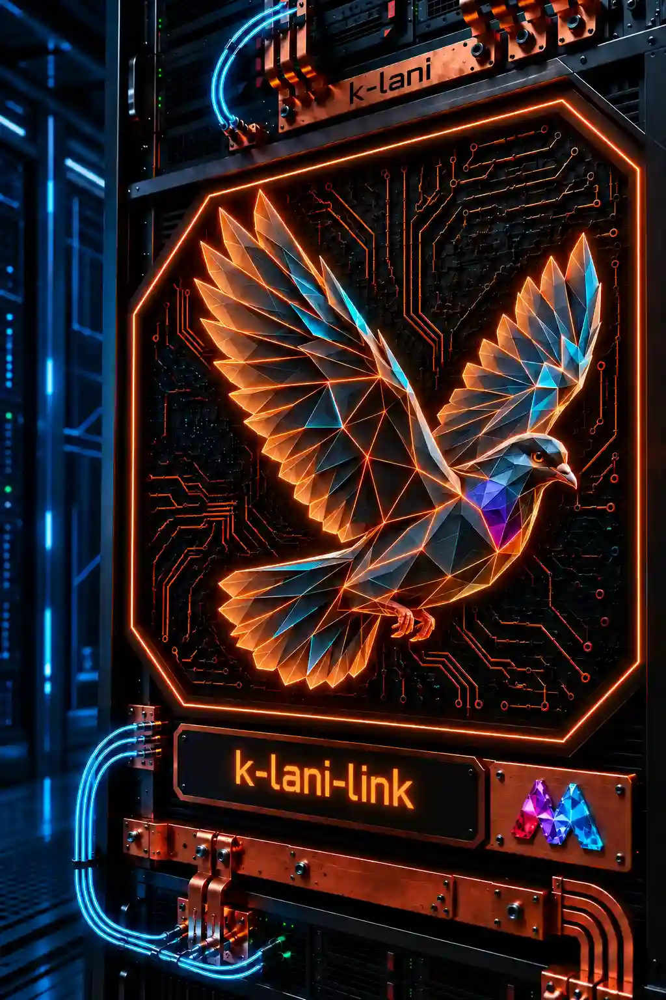
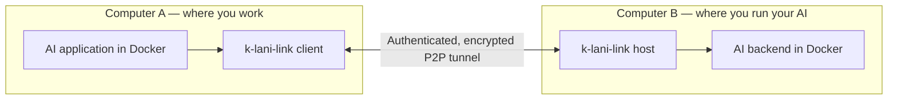
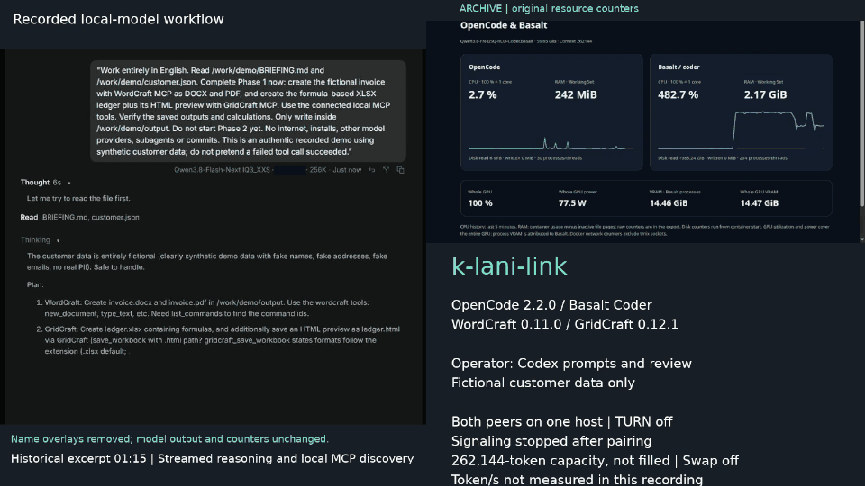

# k-lani-link

<!-- WINDOWS-DOWNLOADS:START -->
## Download for Windows

**[⬇ Download Windows x64 EXE](https://github.com/MarvKalani/k-lani-link/releases/download/v1.2610.29-preview.3/k-lani-link-1.2610.29-preview.3-windows-x64.exe)** · **[⬇ OpenCode + Docker setup ZIP](https://github.com/MarvKalani/k-lani-link/archive/refs/heads/main.zip)**

| What do you want to run? | Download | Instructions |
| --- | --- | --- |
| Portable executable on an Intel/AMD PC | [Windows x64 ZIP](https://github.com/MarvKalani/k-lani-link/releases/download/v1.2610.29-preview.3/k-lani-link-1.2610.29-preview.3-windows-x64.zip) | [Native setup](deploy/portable/README.md#windows-connect-to-a-remote-model) |
| Windows on ARM, e.g. Snapdragon | [ARM64 EXE](https://github.com/MarvKalani/k-lani-link/releases/download/v1.2610.29-preview.3/k-lani-link-1.2610.29-preview.3-windows-arm64.exe) · [ARM64 ZIP](https://github.com/MarvKalani/k-lani-link/releases/download/v1.2610.29-preview.3/k-lani-link-1.2610.29-preview.3-windows-arm64.zip) | [Native setup](deploy/portable/README.md#windows-connect-to-a-remote-model) |
| OpenCode in the browser, isolated with `D:\OpenCode` | [Current Docker setup ZIP](https://github.com/MarvKalani/k-lani-link/archive/refs/heads/main.zip) | [Docker Desktop setup](deploy/desktop/README.md) |

**Latest published portable version: 1.2610.29-preview.3 (preview).**
[Release notes](https://github.com/MarvKalani/k-lani-link/releases/tag/v1.2610.29-preview.3) · [Changes since this build](https://github.com/MarvKalani/k-lani-link/compare/v1.2610.29-preview.3...main) · [SHA-256 checksums](https://github.com/MarvKalani/k-lani-link/releases/download/v1.2610.29-preview.3/SHA256SUMS) · [macOS / Linux / all downloads](https://github.com/MarvKalani/k-lani-link/releases)

The Docker ZIP contains the current source and launcher; build its images locally once. The EXE provides the transport only, without the OpenCode UI; source pushes do not rebuild published binaries. Docker Desktop / company-network acceptance is still pending.
<!-- WINDOWS-DOWNLOADS:END -->

> **MVP development snapshot:** Linux Docker deployment validated. License sales remain paused while the purchase flow is prepared.

### Your AI, wherever you run it. Your apps, wherever you work.

[Deutsch](README.de.md) · [Get started](QUICKSTART.md) · [Changelog](CHANGELOG.md) · [Support on Ko-fi](https://ko-fi.com/mkalani)

**k-lani-link is an encrypted bridge between your AI applications and an AI endpoint on another computer you choose.**

That computer can be a workstation at home, a machine in your office, or a GPU
server in a data center. Your application connects to a local OpenAI-compatible
API; k-lani-link carries the requests and streamed responses between the two
computers. The model runs on the backend machine, so your working computer
doesn't need its own inference GPU.

Connect any application that supports the relevant OpenAI-compatible API and
a custom endpoint: coding tools, chat interfaces, scripts or your own software.
OpenCode and Cline are examples of clients, not a limit on the bridge.
**From computer X to computer Y: choose the AI you want to reach.** That can be
a model you run yourself or an endpoint another operator makes available to you.
**Bring any backend that implements the supported OpenAI-compatible chat endpoints.**
The transport is separate from the inference engine. Basalt is the tested reference
deployment; other local backends use an explicit opt-in.
[See compatibility and setup](#choose-your-app-and-backend).

## What you get

| Benefit | How k-lani-link delivers it |
| --- | --- |
| Use compute on another machine | Keep the model where your GPU and storage are; connect your apps through a local API. |
| See the answer as it arrives | Streams text, reasoning and tool-call deltas without waiting for the whole response. The backend and app determine which features are available. |
| Change models without pairing again | The optional Basalt supervisor loads and unloads approved models while keeping the tunnel connected. |
| Serve more than one request | Configure up to eight streams per tunnel with a bounded queue; the backend must support the chosen concurrency. |
| Keep inference traffic between your chosen peers | Authenticated WebRTC with additional content encryption. The intermediary handles encrypted connection setup and is disconnected once the tunnel is ready. |
| Choose your infrastructure | Configure your own signaling and STUN servers. TURN is off by default and requires explicit opt-in. |
| Isolate the applications | Docker recipes give the AI client and model server no Internet route. Dedicated transport components carry the connection. |
| Use it without an activation service | No online license check, device registration or recurring fee for the 1.x software license. |

## Two computers. Two isolated applications. One encrypted connection.

The Docker reference setup isolates **two application containers**: your AI
client on one side and the inference server on the other. Small additional
containers provide the transport and, where needed, browser access. The apps
use private Unix sockets; k-lani-link handles networking. Both sides can also run
on one machine for testing.

This arrangement lets you work with a remote model without exposing its raw API
as a public service. The supplied local-model profile keeps inference on your
chosen computers. k-lani-link has no traffic logging or telemetry. Fixed startup diagnostics help
with invalid configuration and pairing errors without echoing keys or supplied
values. Optional resource measurements record counters, not prompts or answers.

## Choose your app and backend

**Client side:** use an app that accepts a custom OpenAI-compatible base URL,
API key and model ID. k-lani-link forwards model listing, Chat Completions and
Responses requests. It preserves their API format; it does not translate one
API into another. OpenCode, ThinkRail/Pi and the Codex agent core have been
tested. A Cline configuration is also documented.

**Backend side:** use an OpenAI-compatible chat server, such as
[Basalt](https://github.com/jesdga95/basalt),
[Strata](https://github.com/niko1221/strata),
[Maya](https://github.com/mw00/project-maya),
[LM Studio](https://lmstudio.ai/docs/developer/openai-compat),
[llama.cpp](https://github.com/ggml-org/llama.cpp),
[vLLM](https://docs.vllm.ai/) or [Ollama](https://docs.ollama.com/api/openai-compatibility).
These are examples, not a fixed list of supported engines. Client and server must
support the same endpoint and requested features, including streaming and tool calls.

| Connection | Current status |
| --- | --- |
| Basalt reference deployment | Tested, including Docker isolation and optional model controls |
| Other local OpenAI-compatible chat servers | Generic connection available; integration and privacy validation remain backend-specific |
| Gateway to cloud providers | Planned, with explicit cloud-use settings |

The inference routes are `/v1/models`, `/v1/chat/completions`, `/v1/responses` and
`/v1/embeddings` (OpenAI) and `/v1/messages` (Anthropic, for Claude Code with your own
model); see [supported APIs](REFERENCE.md#supported-apis).
Model loading, KV-cache storage and other administration are separate capabilities.
[API conventions and Open Responses](deploy/BACKENDS.md#api-conventions-and-open-responses).

**Other local servers:** by default the host requires the backend's privacy
profile. To use another local OpenAI-compatible server, explicitly set `allow_unverified_backend = true` in
`host.toml` and configure its loopback `upstream`. k-lani-link then skips that
profile check and warns at startup; the encrypted peer connection is unchanged.
You must assess the backend's logging, storage and network access yourself.
Our Basalt-specific model controller cannot be enabled with this opt-in.
[Connection example and exact limits](deploy/BACKENDS.md#connect-another-local-server).

**Planned cloud gateway:** computer B could also call OpenAI or another provider
on your behalf. That adapter is still to be built. The selected provider would
receive the inference data; this is a separate operating mode from the isolated
local-model setup.

[Client configuration and protocol reference](REFERENCE.md) · [Backend capabilities and roadmap](deploy/BACKENDS.md)

## Tested in a local workflow

OpenCode used a local Qwen model through Basalt and the encrypted connection to
create a **customer invoice, PDF, Excel ledger and English project website**
with WordCraft/GridCraft. All customer data was fictional; CPU, RAM and GPU
measurements accompanied the run.

**[Watch / download the English demo (MP4, 87 seconds)](https://github.com/MarvKalani/k-lani-link/releases/download/v1.2610.31-preview.1/k-lani-link-business-demo.mp4)**
· [Editing notes and GIF downloads](assets/demo/README.md)

This is an edited archive of the 27–28 October run, not a new inference run.
Old name overlays and provider labels are masked; the selected model output and
resource counters are unchanged. Codex supplied prompts, follow-ups and review.
Both peers ran on one machine, with fictional data. The recording predates the
token/s exporter; no later performance figures have been inserted.
The documents remain unchanged; later website wording and artwork edits are
identified in [the provenance notes](website/README.md).
[Hardware and measurements](deploy/HARDWARE.md) · [Demo workflow](deploy/opencode/DEMO.md).

The newer model-control test switched **Coder → NVFP4 → Coder → unloaded**
through one existing tunnel, with signaling stopped. Twelve short requests ran
in pairs; both model files were on the same RAID 0 filesystem. The successful
profile used 6 GiB backend RAM, no swap and two slots configured for 262,144 tokens
each. Those contexts were not filled; this is a functional test, not a throughput
or answer-quality benchmark. [Results and limits](deploy/managed/validation-20261028.json)
· [Reproduce the test](deploy/managed/README.md#reproduce-the-gpu-validation).

**Development update:** the [seven-carrier comparison](deploy/mailbox-bench/DECISION.md)
now includes 63 controlled cases: 50/100 tokens per second, 1/10 tunnels,
60-second workloads, proxy buffering and reconnection. The selected acknowledged
multi-record mailbox is now wired as an **explicit source preview** with verified TLS,
durable paired-state folders and host/gateway SSE forwarding. [Private HTTPS setup,
tests and limits](deploy/https/README.md). Published preview.3 downloads and the browser
connection panel still use WebRTC; HTTPS is not an automatic fallback. This preview
is not a public relay or a throughput guarantee. [Implementation checklist](docs/HTTPS-IMPLEMENTATION.md)
· [Original delivery contract](docs/DESIGN-MAILBOX.md) · [Changelog](CHANGELOG.md).
The [actual application-path load tests](deploy/https/RESULTS.md) first exposed a
response flow-control bottleneck; after the documented correction all four synthetic
50/100-token/s workloads complete live. HTTPS remains private test work until real
WAN, proxy and inference acceptance tests pass.

## Start with Docker

The current reference deployment targets **Linux x86_64 with Docker Compose**.
The tested Basalt backend also needs a supported NVIDIA GPU, NVIDIA Container
Toolkit and a compatible model file. Model weights are supplied by you.

1. Build the images and create a private pairing code.
2. Start the backend and k-lani-link host on computer B.
3. Start k-lani-link and your application on computer A, then configure its local API endpoint.

**[Follow the two-computer setup guide →](QUICKSTART.md)**

**Windows with Docker Desktop:** a separate [browser-based OpenCode profile](deploy/desktop/README.md)
mounts only `D:\OpenCode` as the project directory. OpenCode has no external network
interface; k-lani-link handles the peer connection through a private socket.
The PowerShell launcher builds/starts the stack and checks its boundaries. The
Windows/Docker Desktop and real company-network acceptance test is still pending.

Both peers need network access. Across the Internet, their networks must allow
direct peer traffic; Internet access alone does not guarantee NAT traversal.
If direct ICE cannot connect, **you must currently bring your own TURN server**
and explicitly configure its address and credentials. k-lani-link does not operate
or supply a TURN service. There is no automatic relay fallback.

## Portable Windows, macOS and Linux builds

Prefer a native program? The portable variants use one executable, with no
installer: Windows x64/ARM64, macOS Intel/Apple Silicon and Linux x64/ARM64.
Starting the new UI preview without arguments opens a local connection panel;
PowerShell/terminal commands remain available. It includes configuration import,
live connection status and a real backend/model-list test.
The initial downloads are unsigned previews; security software or company policy
may block them. Native operation does not provide Docker's application isolation.
[Downloads](https://github.com/MarvKalani/k-lani-link/releases)
· [Setup, platform limits and checksums](deploy/portable/README.md).

## €4.99 once. All 1.x releases.

One license covers **one person**, on any number of devices and containers,
including AI agents acting for that person. Teams buy one seat per human user.
There is no online activation.

Production use is free for individuals acting on their own behalf with annual
gross income below **USD 100,000**, and for organizations with consolidated
group annual revenue below **USD 100,000**. For company work, the group's revenue
applies. Non-production evaluation is permitted under the BSL regardless of
those thresholds.

**License sales remain paused while the purchase flow and terms are prepared.**
· [Free-use conditions and user definition](LICENSING.md)
· [Commercial terms](COMMERCIAL-LICENSE.md)

Source is available under **BSL 1.1**. This version changes to Apache-2.0 on
28 October 2030 under the [license terms](LICENSE). The price covers k-lani-link;
model weights, compute, cloud-provider charges and TURN service are separate.

## Support development

If you would like to support the project independently of a license purchase,
you can **[support Marvin on Ko-fi](https://ko-fi.com/mkalani)**.
Contributions are voluntary and do not purchase or replace a required license.

## Current release scope

The public `main` branch is an MVP development snapshot. Concurrency is configurable from one to eight streams per tunnel with a bounded
queue (one stream by default). An opt-in Basalt supervisor loads and unloads
allowlisted models while the tunnel stays connected. Saved KV state and a browser
extension are not yet available. See [model control and parallel streams](deploy/managed/README.md). SIGTERM/Ctrl-C now clean up unused pairing
reservations; a code consumed by an established tunnel still stays consumed.
The recorded demo ran both peers on one host;
it does not establish performance between independent Internet connections.

Changes are recorded in [CHANGELOG.md](CHANGELOG.md). Tagged versions and their
downloadable assets belong on [GitHub Releases](https://github.com/MarvKalani/k-lani-link/releases).
The current source is an MVP. Portable builds have their own native CI checks;
published versions identify their source commit and validation limits. See the
[portable guide](deploy/portable/README.md) for signature status and platform support.

k-lani-link transports AI API requests. Remote desktop, arbitrary file access and
other network services are outside its scope. A client may keep local history
and write files. Encryption and Docker isolation support a privacy-conscious
deployment; lawful processing and GDPR compliance still depend on its operation.

[Security model](SECURITY.md)
· [Technical reference](REFERENCE.md)
· [Third-party licenses](THIRD_PARTY.md)

[Name change and existing installations](docs/REBRANDING.md)
