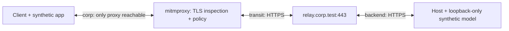

# Corporate HTTPS inspection laboratory

Run the real k-lani-link client, host and relay behind an inspecting **forward proxy**.
The only simulated application is the deterministic model server. The proxy terminates
client TLS with a private laboratory CA, verifies the origin certificate, applies an
exact-domain allowlist, and forwards the still end-to-end encrypted records.

**[Verified results and supported product statements](RESULTS.md)**

This is a reproducible Linux/Docker experiment. It does not establish compatibility
with a particular company's gateway, reputation feed, Windows endpoint policy, PAC,
NTLM or Kerberos. A native Windows run and a real corporate pilot are separate acceptance steps.

## Run

Requirements: Linux x64, Python 3.11+, Docker Engine, OpenSSL, the repository's Rust
toolchain and the `x86_64-unknown-linux-musl` target plus musl C compiler. Use the same
Docker permissions as the existing HTTPS lab. The runner does not change host trust,
manual host firewall rules, swap, or running application/model containers. Docker manages
the temporary bridge-network rules as part of its normal container lifecycle.

```sh
rustup target add x86_64-unknown-linux-musl
python3 -B deploy/proxy-lab/run.py
```

The command builds the current CLI with `--locked --release`, builds a small endpoint
instrumentation image, pulls the pinned mitmproxy image when necessary, and runs the
scenarios sequentially. Downloads occur during preparation; runtime networks are internal.
No production configuration, GPU, model directory, Docker socket or host port is exposed
to the laboratory containers.

For an individual scenario during development:

```sh
python3 -B deploy/proxy-lab/run.py --cases json_only
```

`--skip-build` reuses the existing musl binary and records its hash; it is only appropriate
after deliberately building the binary you want to test. `--keep-private-state` keeps
the synthetic credentials and certificates for local debugging. Containers and networks
are cleaned up in either mode. The small test images remain cached.

Reports are written under `.release/proxy-lab-<UTC>-<id>/`:

- `REPORT.md`: outcome table and acceptance limits.
- `report.json`: assertions, measurements, binary/image/source hashes and backend execution counts.
- `*-audit.jsonl`: sanitized inspection evidence; no HTTP headers, full URLs, tokens or bodies.
- Build logs; private test state is deleted by default.

The command exits nonzero if any assertion fails. A successful Docker build alone is
not a successful scenario. Only a matching expected observation is counted as PASS.

## Network and trust boundaries



The client belongs only to the internal `corp` network. The proxy joins `corp` and
`transit`. The relay joins `transit` and `backend`; the model host joins only `backend`.
The positive baseline probes that the proxy is reachable and the relay/model addresses
are not directly reachable from the client.

There are two independent temporary CAs:

1. The **origin CA** signs the relay certificate. The proxy and model host trust it.
2. The **inspection CA** signs the certificates presented to the client. Only the
   proxy receives this CA's private key; the client receives its public certificate.

Certificate verification remains enabled on both TLS legs. No CA is installed in the
workstation's trust store. The missing-CA and invalid-origin cases verify these boundaries.
All normal containers run as the invoking user, without Linux capabilities, with a
read-only root filesystem, bounded resources and no host network.

## Scenarios and acceptance

| Scenario | Required observation |
| --- | --- |
| `inspected_https` | Authenticated connection, ordered complete stream, actual TLS inspection, no direct client-to-relay/model route |
| `pairing_by_code` | Actual offer/join code exchange through inspection, followed by a stream through the newly paired endpoints |
| `domain_denied` | CONNECT denied by the exact-domain rule; no model execution |
| `missing_inspection_ca` | Client rejects the proxy certificate; no model execution |
| `wrong_origin_name` | Proxy rejects the origin hostname mismatch |
| `expired_origin_certificate` | Proxy rejects the expired origin certificate |
| `basic_proxy_auth` | Explicit proxy credentials accepted and complete stream |
| `http1_only` | HTTP/1.1 negotiated and complete stream |
| `post_only` | Initial PUT rejected, automatic POST adaptation, complete stream |
| `json_only` | PUT and binary POST rejected, automatic JSON POST adaptation, complete stream |
| `buffered` | Finite request/response bodies buffered and delayed; stream stays complete |
| `lost_write_ack` | One accepted write's acknowledgement is lost; no duplicate model execution |
| `proxy_restart` | Proxy restarted during a response; response recovery and ordering checked |
| `revoke_domain` | Existing connection loses permission; subsequent work does not reach the model |
| `revoke_token` | Client admission token changed and relay restarted; work submitted during recovery refused, explicit 401 and access-denied state observed |
| `tampered_record` | Inspector corrupts a returned sealed record; no successful fabricated answer |
| `blocked_quic` | Enabled HTTP/3 attempts UDP, namespace firewall rejects it, same client completes over TCP |

The explicit-proxy cases have HTTP/3 disabled, as required by k-lani-link's configuration.
The separate QUIC case connects the client to the isolated transit network and uses a
short-lived helper with **NET_ADMIN only in that client's network namespace** to reject
UDP 443. Its rule counter must show actual dropped packets. The rule is scoped to the
test client's namespace, not the host firewall.

The token-revocation case allows up to 40 seconds for the existing connection's recovery
window to end and the client to observe a fresh 401. It records that observation time
and checks that work submitted during the window does not execute. This distinguishes
an actual token rejection from a temporarily unreachable relay.

The synthetic backend emits numbered events tied to a unique request ID. The receiver
checks content, ordering, event count and the final marker. Backend counters detect
duplicate execution. Inspection scans for known synthetic question/answer markers,
including inside decoded JSON/base64 wrappers; only hashes and booleans are retained.
Marker absence is a regression check, not a cryptographic security audit.

The allowlist is an explicit lab policy, **not** a vendor URL-category database.
Revoking the domain denies all request representations, including POST/JSON. Compatibility
fallbacks must not turn a denied destination into a permitted one.

## From this lab to an IT-approved pilot

Use a dedicated company-controlled relay hostname and an approved model endpoint. Have
the IT team provision the proxy address, the application-specific CA bundle and individual
revocable credentials. Limit the gateway rule to the pilot devices/users and selected
hostname. Record the actual gateway product/version and effective policies in the pilot report.

The proxy can inspect the outer HTTP headers and metadata, including admission credentials;
configure logging accordingly. Prompts and answers remain application-encrypted. If the
organization requires content DLP, enforcement must happen at an approved endpoint before
encryption or after decryption; that is not provided by this laboratory.

Repeat pairing, streaming, restrictions and revocation with the actual native Windows
application and an approved model. Record proxy authentication requirements explicitly:
Basic CONNECT in this lab does not validate PAC, NTLM or Kerberos.

References: [mitmproxy forward mode](https://docs.mitmproxy.org/stable/concepts/modes/#regular-proxy),
[inspection certificates](https://docs.mitmproxy.org/stable/concepts/certificates/),
[event hooks](https://docs.mitmproxy.org/stable/api/events.html),
[own-domain relay setup](../https/README.md#configure-a-private-relay).
